# Hướng dẫn sử dụng - Sổ Chủ Nhiệm Số & Studio TVC360

Phiên bản: 4.0 (end-to-end mọi flow + mục lục) · Ngày: 07/11/2026
Địa chỉ hệ thống: https://sochunhiem.vieschool.com · Trang pháp lý công khai: `/legal/privacy`, `/legal/terms`

Tài liệu này hướng dẫn thao tác theo từng vai trò **end-to-end**, mỗi vai trò kèm tài khoản đăng nhập demo ngay đầu mục. Xem thêm `MO-TA-CHUC-NANG.md` để biết mô tả chi tiết từng chức năng.

Tài liệu liên quan trong cùng thư mục:

- `KHOI-TAO-TRUONG-MOI.md` - hướng dẫn đưa trường mới lên hệ thống từ con số 0 (kèm file Excel import `docs/templates/khoi-tao-truong.xlsx`).
- `KICH-BAN-DEMO.md` + `KICH-BAN-DEMO.pptx` - kịch bản demo theo luồng vai trò, dạng slide trình chiếu.

---

## Mục lục

**Phần A - Đăng nhập & khái niệm chung**

1. [Đăng nhập, tài khoản demo, vai trò kiêm nhiệm](#1-đăng-nhập)

**Phần B - Hướng dẫn theo vai trò**

2. [Giáo viên chủ nhiệm (GVCN)](#2-giáo-viên-chủ-nhiệm-gvcn)
   - 2.1 Dashboard · 2.2 Điểm danh · 2.3 Báo cáo ngày cho BGH & thông báo PH · 2.4 Theo dõi chuyên cần · 2.5 Sổ điểm · 2.6 Thời khóa biểu · 2.7 Sổ đầu bài · 2.8 Sơ đồ lớp & tổ & Ban cán sự · 2.9 Rèn luyện · 2.10 Liên lạc phụ huynh · 2.11 Hoạt động giáo dục E2E · 2.12 Tư vấn & an toàn · 2.13 Kỳ thi, thi đua, năng lực GV · 2.14 Kế hoạch, KPI, lịch năm học · 2.15 Sổ chủ nhiệm - nộp & ký duyệt · 2.16 Học bạ số TT22/2021 · 2.17 Biến động & bữa ăn & y tế · 2.18 Thi trực tuyến LMS E2E
3. [Giáo viên bộ môn (GVBM)](#3-giáo-viên-bộ-môn-gvbm)
4. [Tổ trưởng chuyên môn](#4-tổ-trưởng-chuyên-môn)
5. [Ban Giám Hiệu (BGH) / Phó Hiệu trưởng (PHT)](#5-ban-giám-hiệu-bgh--phó-hiệu-trưởng-pht)
6. [Kế toán trường](#6-kế-toán-trường)
7. [Nhân viên y tế trường](#7-nhân-viên-y-tế-trường)
8. [Sở GD&ĐT / UBND cấp xã / Quản trị hệ thống](#8-sở-gđđt--ubnd-cấp-xã--quản-trị-hệ-thống)
9. [Phụ huynh](#9-phụ-huynh)
10. [Học sinh](#10-học-sinh)

**Phần C - Cổng công khai & công cụ chung**

11. [Cổng công khai không cần đăng nhập](#11-cổng-công-khai-không-cần-đăng-nhập)
12. [Studio - công cụ soạn học liệu](#12-studio---công-cụ-soạn-học-liệu)
13. [Mẹo sử dụng & bảng module](#13-mẹo-sử-dụng--bảng-module)

---

## 1. Đăng nhập

Truy cập địa chỉ hệ thống → nhập **Tên đăng nhập** + **Mật khẩu** → **Đăng nhập**.

Môi trường demo: tài khoản theo quy ước tên thật `<tên><viết tắt họ đệm>@<domain trường>` (vd `anhptl@nd.scn` = cô Phạm Thị Lan Anh), mật khẩu chung `demo1234` - danh sách đầy đủ trong `KICH-BAN-DEMO.md`.

### Bảng tài khoản đăng nhập theo vai trò (mật khẩu chung `demo1234`)

| Vai trò trong tài liệu | Tài khoản đăng nhập | Người - vị trí |
|---|---|---|
| Quản trị hệ thống | `admin@demo.scn` | Toàn hệ thống - mọi trường |
| Sở GD&ĐT | `sovqt@demo.scn` | Vũ Quản Trị - xem + quản lý 3 trường |
| UBND cấp xã | `daonvl@demo.scn` | Ngô Văn Lãnh Đạo - dashboard địa bàn, chỉ đọc |
| Hiệu trưởng (BGH) | `hainv@nd.scn` | Nguyễn Văn Hải - HT Nguyễn Du, kiêm dạy |
| Phó Hiệu trưởng (PHT) | `duclm@nd.scn` | Lê Minh Đức - PHT cơ sở 2, kiêm dạy |
| Tổ trưởng chuyên môn | `hanhlth@nd.scn` | Lê Thị Hồng Hạnh - Tổ Toán-TN |
| GVCN (kiêm nhiệm) | `anhptl@nd.scn` | Phạm Thị Lan Anh - GVCN 8A2 + GVBM + tổ trưởng |
| GVBM (đơn vai trò) | `minhtv@nd.scn` | Trần Văn Minh - GV Vật lý |
| Kế toán trường | `trangpt@nd.scn` | Phạm Thu Trang |
| Phụ huynh | `annv@nd.scn` | Nguyễn Văn An - bố em Bảo 8A2 |
| Học sinh | `baong@nd.scn` | Nguyễn Gia Bảo - lớp 8A2 |
| GVCN tiểu học | `oanhdtk@cva.scn`, `ngaltt@kd.scn` | GVCN 3A2 - TH Chu Văn An / TH Kim Đồng |
| BGH tiểu học | `phuongttm@cva.scn`, `longhd@kd.scn` | Hiệu trưởng 2 trường tiểu học |

Trường trải nghiệm khách (TRIAL01 - chỉ mở tính năng lõi + chuyên cần, mật khẩu `Trial@2026`): `hieutruong@trial.scn`, `chunhiem@trial.scn`, `giaovien@trial.scn`.

Bộ dữ liệu demo gồm 3 trường có cơ cấu nhân sự sát thực tế: **THCS Nguyễn Du** (12 lớp, 2 cơ sở), **Tiểu học Chu Văn An** (15 lớp), **Tiểu học Kim Đồng** (10 lớp). Mỗi trường có đủ Hiệu trưởng/Phó HT, kế toán, tổ trưởng chuyên môn, GVCN từng lớp và GVBM phân về tổ + môn dạy. Danh sách tài khoản và kịch bản demo chi tiết: `KICH-BAN-DEMO.md`.

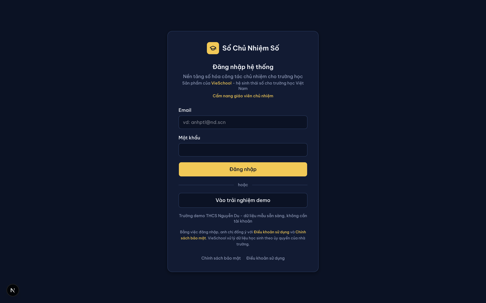

Sau đăng nhập, hệ thống tự chuyển đến trang chủ theo vai trò. Thanh bên trái là menu chức năng được phân quyền riêng cho vai trò của bạn - chỉ những chức năng bạn được phép truy cập mới hiển thị; truy cập trực tiếp link không thuộc quyền sẽ bị đẩy về trang chủ. Góc trên phải: tìm nhanh (Ctrl+K), thông báo, tài khoản, đăng xuất.

**Vai trò kiêm nhiệm (multi-role)**: một người có thể giữ nhiều vai trò cùng lúc - thực tế GVCN luôn kiêm dạy bộ môn, Hiệu trưởng có thể kiêm dạy. Khi đó:

- Thanh trên cùng hiển thị đủ các vai trò, vd `Giáo viên chủ nhiệm · Giáo viên bộ môn · Tổ trưởng chuyên môn`.
- Menu trái là **hợp của mọi vai trò** (vai trò chính đứng trước), đã lọc trùng - chỉ hiện chức năng ít nhất một vai trò của bạn được phép.
- Quyền truy cập tính trên toàn bộ vai trò: GVCN kiêm tổ trưởng vào được mục Tổ chuyên môn như tổ trưởng thường.
- BGH gán vai trò kiêm nhiệm tại trang **Nhân sự → Tài khoản** (ô "Vai trò kiêm nhiệm" khi tạo/sửa tài khoản).

### Thông báo

Biểu tượng chuông mở trang **Thông báo** (`/notifications`) - tập trung mọi sự kiện liên quan đến bạn: tin nhắn mới, lịch hẹn, kết quả ký duyệt sổ, giáo án được duyệt/trả về, sự cố mới... Mỗi mục có link nhảy thẳng tới màn hình liên quan; bấm vào để đánh dấu đã đọc, hoặc **Đánh dấu tất cả đã đọc**.

### Hồ sơ cá nhân

Trang **Hồ sơ cá nhân** (`/profile`, góc trên phải → tên tài khoản): xem/cập nhật thông tin liên hệ của mình, đổi mật khẩu, xem vai trò được gán. Mọi vai trò đều có.

---

## 2. Giáo viên chủ nhiệm (GVCN)

**Đăng nhập: `anhptl@nd.scn` / `demo1234`** - GVCN lớp 8A2 (THCS Nguyễn Du), kiêm GVBM + tổ trưởng. Tiểu học: `oanhdtk@cva.scn` (3A2), `ngaltt@kd.scn` (3A2).

GVCN là vai trò trung tâm - quản lý toàn bộ hoạt động của lớp chủ nhiệm.

### 2.1 Dashboard

Trang chủ hiển thị tổng quan lớp: chuyên cần hôm nay (hoặc ngày gần nhất có dữ liệu), sự cố đang mở, việc sắp đến hạn, cảnh báo học sinh.

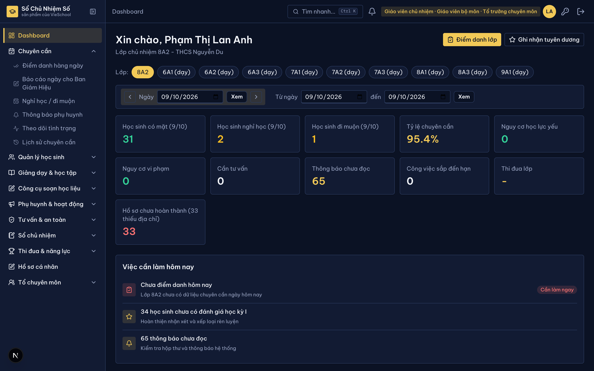

### 2.2 Điểm danh hàng ngày

Menu **Chuyên cần → Điểm danh hàng ngày**.

1. Chọn lớp (nếu chủ nhiệm nhiều lớp).
2. Chọn ngày bằng ô ngày hoặc nút ‹ › để xem/sửa điểm danh ngày cũ - bấm **Xem** để tải dữ liệu ngày đã chọn.
3. Đánh dấu trạng thái từng em: Có mặt / Nghỉ có phép / Nghỉ không phép / Đi muộn.
4. Với em vắng/đi muộn, cột **Ghi chú** hiện ô nhập lý do (VD: "ốm, PH đã báo") - ghi chú lưu cùng điểm danh và hiển thị lại ở sổ vắng/muộn.
5. Bấm **Xác nhận chuyên cần** để lưu.

6 thẻ tổng ở trên cập nhật theo ngày đang xem: Sĩ số, Có mặt, Vắng, Nghỉ có phép, Nghỉ không phép, Đi muộn. Nút **Tải template / Import Excel** hỗ trợ nhập điểm danh hàng loạt.

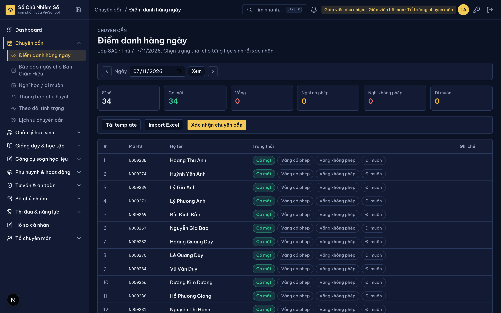

### 2.3 Báo cáo ngày cho BGH & thông báo phụ huynh

- **Báo cáo ngày cho Ban Giám Hiệu** (`/attendance/daily-report`): sau khi điểm danh xong, GVCN gửi báo cáo chuyên cần + ghi chú tình hình lớp trong ngày cho BGH. BGH xem tập trung tại **Báo cáo ngày các lớp** (`/school/daily-reports` - mục 5).
- **Thông báo phụ huynh** (`/attendance/notify`): gửi thông báo vắng/muộn cho PH của các em đã đánh dấu - hệ thống liệt kê sẵn danh sách em vắng/muộn hôm đó, GVCN chỉ việc chọn và gửi (in-app + email).

### 2.4 Theo dõi tình trạng & lịch sử chuyên cần

- **Theo dõi tình trạng**: ma trận học sinh × ngày. Chọn ngày mốc ở ô "Đến ngày" để xem chuỗi vắng/muộn gần đó - phát hiện em vắng liên tục.
- **Nghỉ học / đi muộn**: sổ vắng/muộn theo khoảng ngày - chọn **Từ ngày / Đến ngày** rồi xem danh sách kèm lý do, nguồn ghi (GVCN nhập / Sổ đầu bài / Phụ huynh báo).
- **Lịch sử chuyên cần**: chọn khoảng ngày để xem tỷ lệ chuyên cần, biểu đồ, bảng chi tiết.

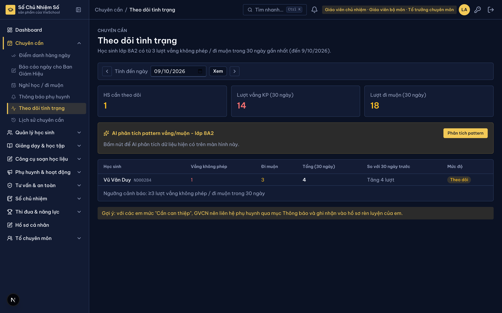
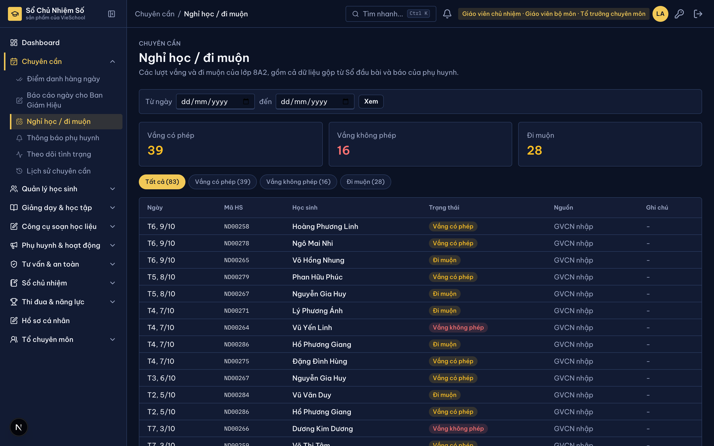
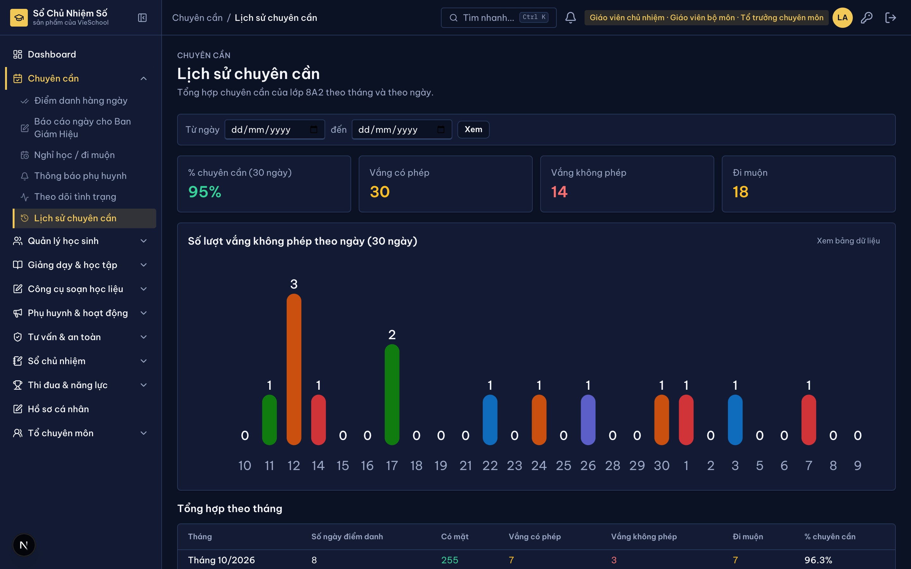

### 2.5 Nhập / đồng bộ điểm (Sổ điểm)

Menu **Học tập → Nhập / đồng bộ điểm**.

1. Chọn **Lớp** + **Môn học** + **Học kỳ** (I/II). GVCN thấy lớp chủ nhiệm **và** các lớp mình đang dạy; GVBM chỉ thấy đúng lớp/môn được phân công trong thời khóa biểu - không nhập được điểm lớp/môn người khác dạy.
2. Bảng điểm gồm các cột: **Miệng, 15 phút, 1 tiết** (hệ số 1 - số cột tùy ý), **ĐĐGgk** (hệ số 2), **ĐĐGck** (hệ số 3).
3. Thêm cột đánh giá thường xuyên: chọn loại ở ô kế nút **Thêm cột điểm** → bấm để thêm. Xóa cột bằng dấu × trên tiêu đề cột.
4. Nhập điểm từng ô (0-10). Cột **ĐTBm** tự tính theo công thức Thông tư 22: `(Tổng ĐGTX + 2×ĐĐGgk + 3×ĐĐGck) / (số ĐGTX + 5)`.
5. Bấm **Lưu điểm**. Khi tải lại trang, các cột đã lưu tự dựng lại đúng loại.

Nhập hàng loạt: **Tải template** → điền Excel → **Import Excel**. Xuất kết quả: chọn mẫu ở ô "Mẫu 1/2/3" → nút xuất.

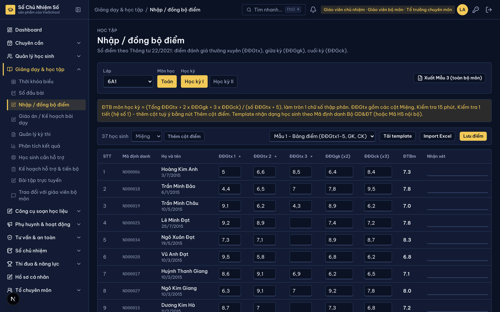

### 2.6 Thời khóa biểu

Menu **Thời khóa biểu & Sổ đầu bài → Thời khóa biểu**. Hai chế độ:

- **Theo lớp** (mặc định): TKB lớp chủ nhiệm của bạn - chip lớp có đánh dấu `(CN)`.
- **Lịch cá nhân**: toàn bộ tiết bạn dạy trong tuần, mỗi ô hiển thị `Lớp · Môn · Phòng`. Tiết bị xếp trùng slot hiển thị chồng kèm viền cảnh báo.

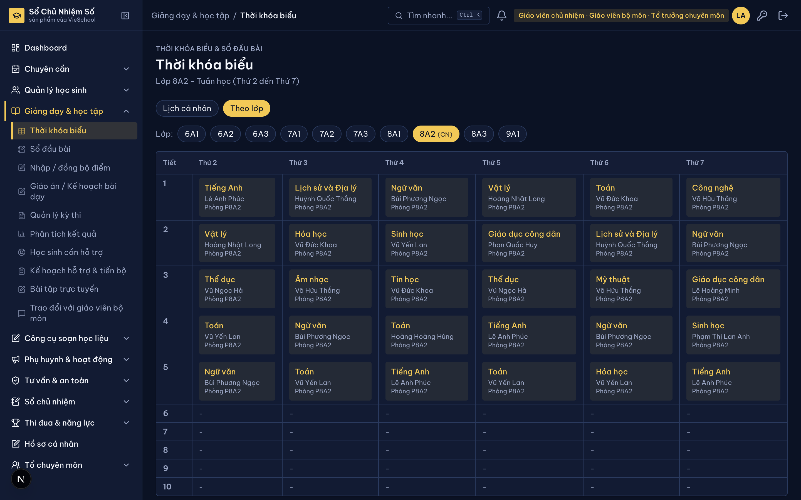

### 2.7 Sổ đầu bài

Menu **Thời khóa biểu & Sổ đầu bài → Sổ đầu bài**. Chọn ngày → danh sách tiết trong ngày hiện dạng thu gọn (tiết, môn, lớp, GV, sĩ số, chip vắng/muộn, trạng thái đã ghi).

**Phân quyền ghi:** chỉ giáo viên được phân công tiết đó mới mở được form nhập. Tiết của giáo viên khác (kể cả lớp mình chủ nhiệm) chỉ xem được ở chế độ đọc - đúng nguyên tắc "ai dạy tiết đó người đó ghi sổ".

Bấm vào tiết của mình để mở form ghi:

1. **Sĩ số có mặt** - tự tính từ đánh dấu vắng/muộn.
2. **Tên bài học** - VD: "Bài 12 - Phép nhân phân số".
3. **Nội dung bài học** - nội dung đã dạy, bài tập giao.
4. **Nhận xét của giáo viên** - nhận xét lớp, cá nhân.
5. Đánh dấu từng em: vắng có phép / vắng không phép / đi muộn.
6. **+/− điểm rèn luyện**: nút +/− cạnh tên em → ghi khen thưởng/vi phạm kèm điểm vào sổ rèn luyện.
7. **Lưu** - hệ thống đồng bộ trạng thái vắng/muộn sang điểm danh ngày.

Nút **AI tóm tắt sổ đầu bài / Tóm tắt tuần** phân tích toàn bộ tiết đã ghi trong tuần.

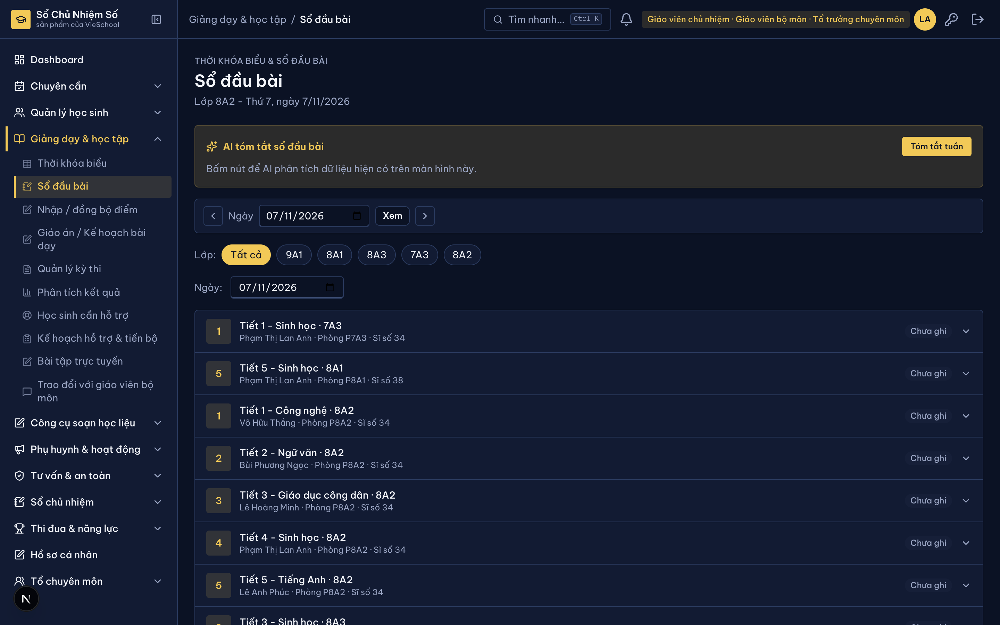

### 2.8 Sơ đồ lớp, danh sách học sinh & hồ sơ

Menu **Sổ chủ nhiệm** / **Quản lý học sinh**:

- **Sơ đồ lớp**: kéo-thả học sinh vào ô ghế. **+ Hàng / − Hàng** và **+ Cột / − Cột** để đổi kích thước lưới (vị trí HS được giữ). **Lưu sơ đồ** tạo phiên bản mới - xem lại ở **Lịch sử phiên bản sơ đồ** (`/register/seating-history`).
- **Danh sách HS & Tổ** (`/register/roster`): **Thêm tổ** → **Chia đều tổ** tự động xếp em vào các tổ; gán Ban cán sự bằng dropdown trên từng dòng; khu vực **Liên kết phụ huynh** để tạo tài khoản PH gắn với HS.
- **Chi tiết hồ sơ học sinh** (`/records/students`): hồ sơ đầy đủ từng em - nhân thân, PH liên kết, điểm, hạnh kiểm, biến động, sự cố liên quan.
- **Lịch sử hồ sơ** (`/records/history`): ai sửa trường nào của hồ sơ HS, khi nào - audit trail phục vụ đối chiếu.
- **Báo cáo tổng hợp (AI)** (`/records/report`): chọn lớp/kỳ → AI viết báo cáo tình hình lớp từ số liệu thật (chuyên cần, điểm, hạnh kiểm) - dùng nộp BGH hoặc họp PH.

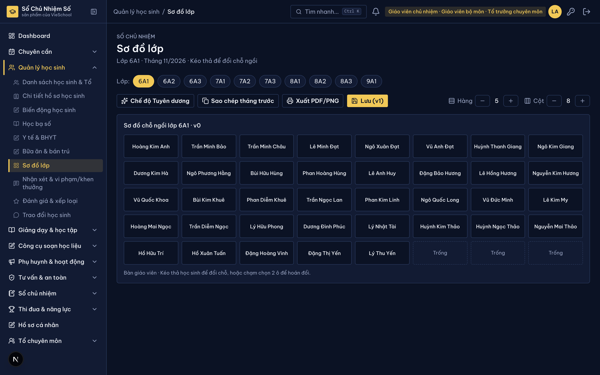
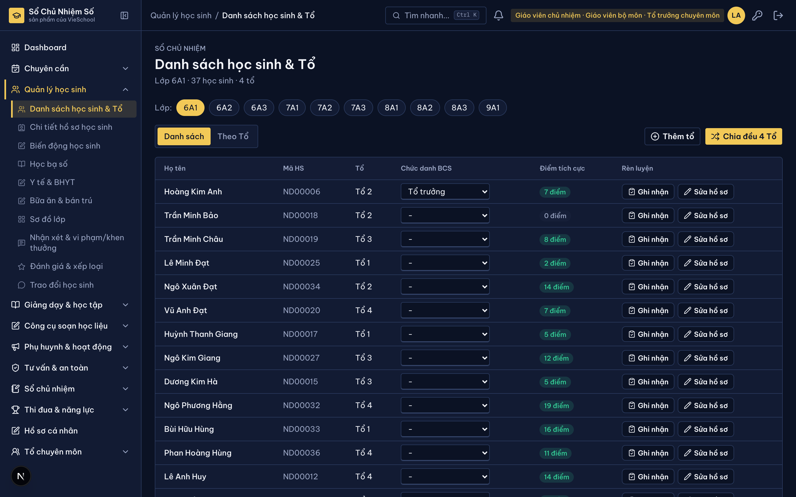

### 2.9 Rèn luyện

Menu **Rèn luyện**:

- **Nhận xét & vi phạm/khen thưởng** (`/conduct/records`): chọn HS, loại (Nhận xét / Khen thưởng / Vi phạm), ngày, điểm (+/−), nội dung → **Ghi nhận**.
- **Đánh giá & xếp loại** (`/conduct/evaluation`): xếp loại hạnh kiểm học kỳ cho cả lớp.
- **Trao đổi học sinh** (`/conduct/student-chat`): nhắn tin riêng với HS qua portal - phục vụ tư vấn nhanh, nhắc việc.

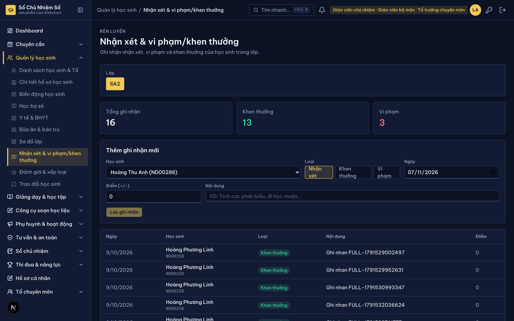

### 2.10 Liên lạc phụ huynh

- **Soạn & gửi thông báo** (`/parents/compose`): chọn phạm vi (cả lớp / PH từng em), nhập tiêu đề + nội dung → gửi. PH nhận trong app + email.
- **Hộp thư phản hồi** (`/parents/inbox`): đọc/trả lời tin nhắn PH.
- **Trao đổi phụ huynh** (`/academics/parent-chat`): hội thoại gắn HS cụ thể - trao đổi về tình hình em đó.
- **Lịch hẹn trao đổi** (`/parents/appointments`): xác nhận/từ chối lịch PH đề xuất.
- **Ban đại diện CMHS** (`/parents/cmhs`): thêm thành viên + vai trò (Trưởng/Phó ban/Ủy viên).
- **Cổng thông tin phụ huynh** (`/parents/portal` - module `phu_huynh_hoat_dong`): xem portal PH nhìn thấy gì.
- **Kênh liên hệ phụ huynh** (`/school/channels` - BGH cấu hình): khai báo kênh chính thức của trường - email + in-app (không có Zalo/SMS).

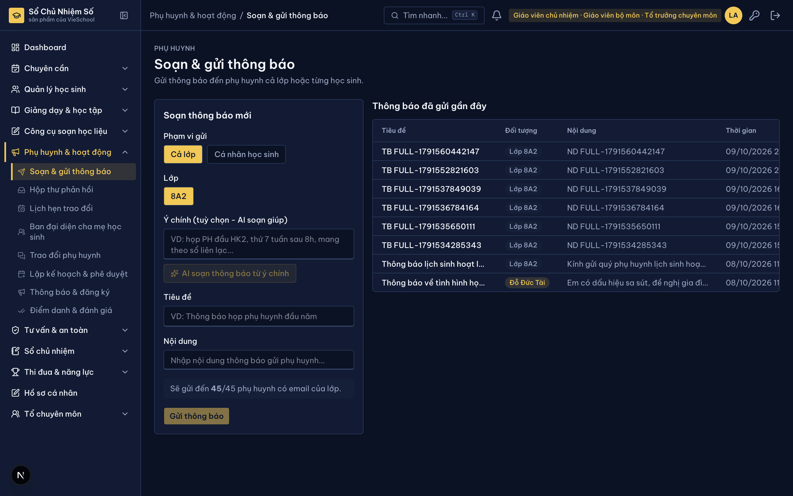

### 2.11 Hoạt động giáo dục E2E (ngoại khóa)

Chuỗi 3 bước: **kế hoạch → công bố & đăng ký → điểm danh & đánh giá** (menu **Phụ huynh & hoạt động**):

1. **Lập kế hoạch & phê duyệt** (`/activities/plan`): GVCN/GV tạo kế hoạch hoạt động (tên, ngày, địa điểm, kinh phí dự kiến, nội dung) → gửi BGH. BGH duyệt tại **Trung tâm phê duyệt** (`/school/approvals` - mục 5) - có thể trả về kèm nhận xét để sửa nộp lại.
2. **Thông báo & đăng ký** (`/activities/announce`): hoạt động đã duyệt được công bố cho PH → PH đăng ký cho con trên portal (mục 9). Màn hình liệt kê ai đã đăng ký/báo vắng.
3. **Điểm danh & đánh giá** (`/activities/attendance`): ngày diễn ra - điểm danh HS tham gia, ghi nhận xét/kết quả hoạt động sau khi kết thúc.

### 2.12 Tư vấn học sinh & an toàn

- **Tư vấn** (menu **Tư vấn & an toàn**): **Tiếp nhận & phát hiện** (`/counseling/intake`) ghi ca mới → **Đánh giá mức độ** (`/counseling/assessment` - có AI gợi ý mức) → ca mức Cao **Chuyển tuyến chuyên gia** (`/counseling/referral`).
- **An toàn**: **Ghi nhận sự cố** (`/safety/report` - loại + mức độ, AI viết lại mô tả) → **Theo dõi & nhắc** (`/safety/followup` - cập nhật tiến độ xử lý, nhắc hẹn) → **Lưu trữ & tra cứu** (`/safety/archive`). BGH xem toàn trường tại `/safety/bgh` (mục 5).

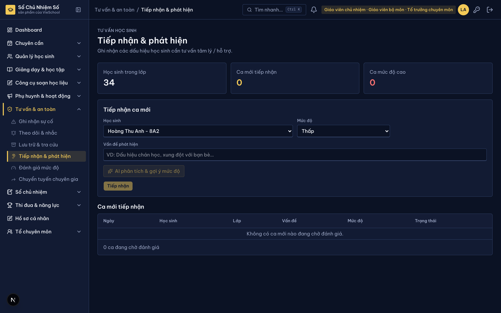
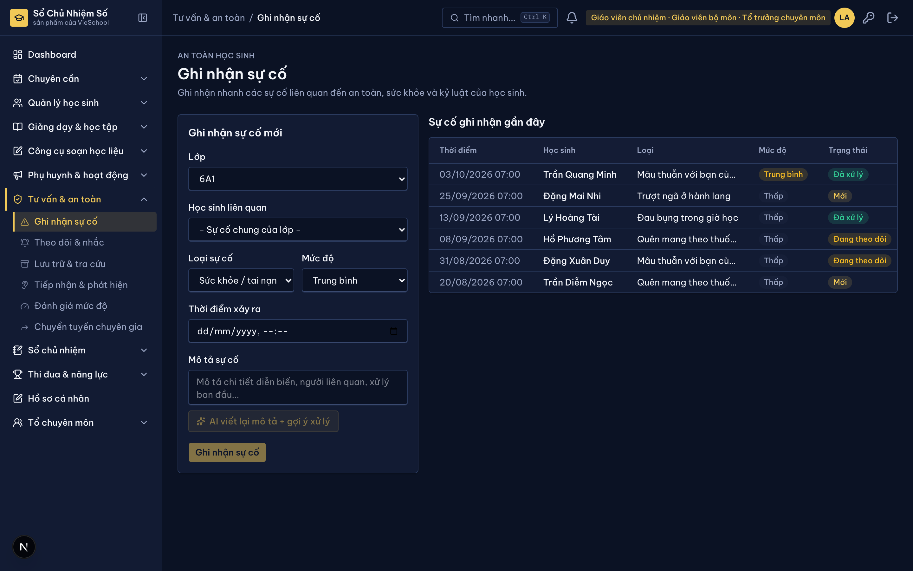

### 2.13 Kỳ thi, thi đua & năng lực giáo viên

- **Quản lý kỳ thi** (`/academics/exams` - module `ky_thi_danh_gia`): tạo kỳ thi → thêm buổi thi (thủ công/Import Excel) → công bố. Nút **Mở ngân hàng câu hỏi** chuyển sang Studio - sinh câu hỏi bằng AI theo môn + khối + chủ đề, gắn YCCĐ, duyệt rồi rút vào đề.
- **Phân tích kết quả** (`/academics/analysis`): sau kỳ thi - phân bố điểm, môn yếu, so sánh lớp.
- **Học sinh cần hỗ trợ** (`/academics/support`) + **Kế hoạch hỗ trợ & tiến bộ** (`/academics/plans`): hệ thống chỉ ra em có nguy cơ → GVCN/GVBM lập kế hoạch hỗ trợ, ghi tiến bộ theo tuần.
- **Thi đua** (module `thi_dua`): **Thu thập & tính điểm** (`/emulation/scoring` - chấm tiêu chí lớp mình) → **Xếp hạng & khen thưởng** (`/emulation/ranking` - bảng xếp hạng toàn trường, đề xuất khen thưởng).
- **Năng lực giáo viên**: **Tự đánh giá & kế hoạch** (`/competency/self-assessment` - GV tự chấm theo chuẩn nghề nghiệp + lập kế hoạch phát triển) → **Minh chứng & đánh giá cuối năm** (`/competency/evidence` - đính minh chứng, tổ trưởng duyệt tại `/team/review` - mục 4).

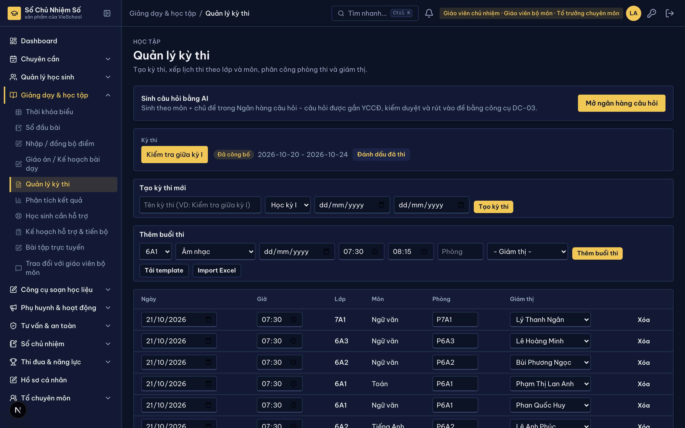
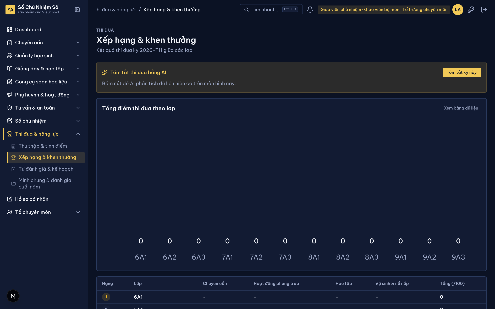

### 2.14 Kế hoạch, chỉ tiêu & lịch năm học

- **Upload lịch năm học** (`/register/year-events`): import Excel các sự kiện/mốc thời gian cả năm - làm nền cho AI gợi ý công việc.
- **Đăng ký chỉ tiêu hiệu suất** (`/register/kpi`): đầu năm GVCN đăng ký chỉ tiêu lớp (tỷ lệ chuyên cần, khá/giỏi...) - hệ thống đối chiếu thực tế trong năm.
- **Kế hoạch tháng / sơ kết tuần** (`/register/plans`): checklist công việc theo tháng + sơ kết tuần.
- **Gợi ý công việc (AI)** (`/register/suggestions`): AI đọc lịch năm học + dữ liệu lớp đề xuất việc cần làm tuần này.

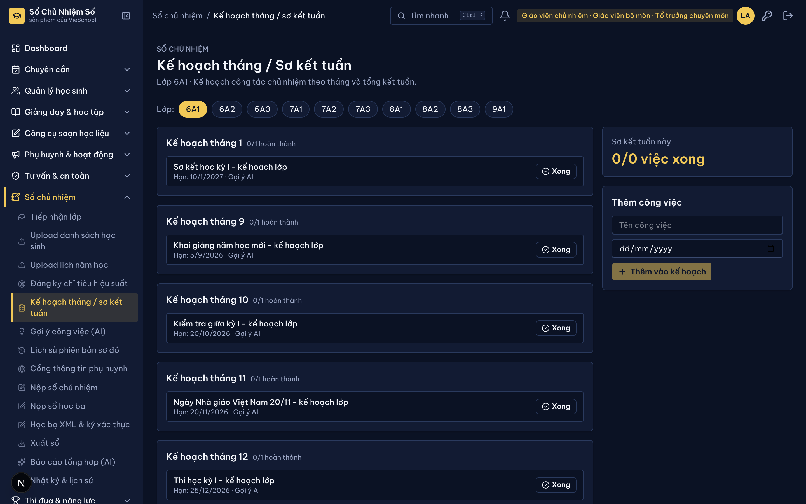

### 2.15 Sổ chủ nhiệm - tiếp nhận, nộp & xuất

- **Tiếp nhận lớp đầu năm** (`/records/intake` + `/records/upload`): đầu năm học - tiếp nhận danh sách HS lớp mới, **Tải template** → điền Excel → **Import** (kiểm tra trùng, báo lỗi từng dòng).
- **Nộp sổ chủ nhiệm cho BGH ký duyệt** (`/register/signoff`): cuối kỳ, BGH mở "đợt ký" cho từng lớp:

  1. Sổ của lớp mình ở trạng thái **Chờ GVCN nộp** → bấm **Nộp sổ** (hoặc **Nộp tất cả** khi chủ nhiệm nhiều lớp).
  2. Trạng thái chuyển **Chờ BGH duyệt** - BGH nhận thông báo.
  3. Nếu BGH **từ chối**, sổ về trạng thái **Bị từ chối** kèm lý do - sửa lại dữ liệu rồi bấm **Nộp lại**.
  4. Khi BGH ký xong, trạng thái **Đã ký** - sổ khóa, chỉ BGH mở lại được.

  Mọi chuyển trạng thái đều gửi thông báo cho bên kia và ghi audit log.

- **Xuất sổ** (`/register/export`): tải CSV toàn bộ dữ liệu sổ chủ nhiệm.
- **Nhật ký & lịch sử** (`/register/audit`): mọi thao tác trên sổ - ai, làm gì, khi nào.

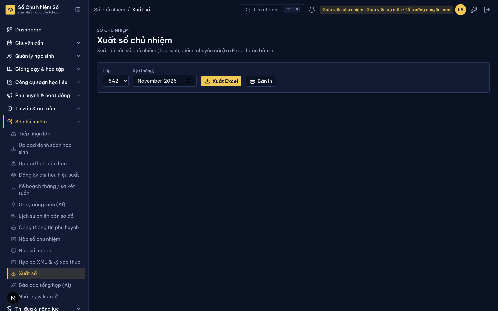

### 2.16 Học bạ số - xếp loại cuối năm (TT22/2021)

Menu **Hồ sơ lớp học → Học bạ số** (`/records/hoc-ba`). Học bạ thay thế sổ học bạ giấy: tổng hợp điểm HK1/HK2/cả năm từng môn, hạnh kiểm, năng lực phẩm chất, chuyên cần (buổi) và quyết định cuối năm - duyệt điện tử, khóa sau khi BGH ký.

**Bước 1 - GVCN ra quyết định** (đăng nhập `anhptl@nd.scn` - GVCN lớp 8A2):

1. Chọn lớp → danh sách HS kèm gợi ý hệ thống (KQ học tập, KQ rèn luyện, danh hiệu, lên lớp tính theo TT22).
2. Bấm tên HS → màn hình chi tiết: bảng điểm từng môn (HK1/HK2/CN, môn nhận xét hiển thị Đạt/Chưa đạt), hạnh kiểm, NLPC, chuyên cần buổi.
3. Chọn **Kết quả học tập**, **Kết quả rèn luyện**, **Danh hiệu**, **Quyết định lên lớp**. Nếu khác gợi ý hệ thống, phải chọn **Căn cứ pháp lý** (Điều 9.3 TT22 / sau đánh giá lại / HS khuyết tật / miễn môn) + ghi chú - nút Lưu mới mở.
4. **Lưu nháp** (riêng lưu sau) hoặc **Trình Ban Giám Hiệu duyệt** ngay - BGH nhận thông báo.

**Bước 2 - BGH duyệt** (đăng nhập `hainv@nd.scn` - Hiệu trưởng):

1. Vào **Học bạ số** → chọn lớp → HS có quyết định "Chờ duyệt".
2. **Duyệt** (có thể kèm nội dung giấy khen) hoặc **Trả lại** - bắt buộc lý do ≥ 10 ký tự, GVCN nhận thông báo kèm lý do.
3. Bị trả lại: GVCN sửa → **Trình lại** (hệ thống ghi "lần trình 2").

**Bước 3 - Khóa sổ học bạ** (BGH `hainv@nd.scn` → GVCN `anhptl@nd.scn` → BGH):

1. BGH vào **Duyệt & khóa sổ học bạ** (`/register/lock-records`) → **Tạo đợt duyệt** cho các lớp.
2. GVCN `anhptl@nd.scn` → cùng màn hình → **Nộp sổ** lớp mình.
3. BGH → **Duyệt & khóa** → toàn bộ quyết định đã duyệt của lớp chuyển "Đã khóa", không ai sửa được nữa.

**Xuất học bạ**: nút **Xuất DOCX / Xuất PDF** trên chi tiết HS (GVCN lớp mình, BGH - BGH xuất được cả lớp 1 file). Học bạ chưa duyệt in watermark "BẢN NHÁP - CHƯA DUYỆT".

**Học bạ XML & ký xác thực** (`/records/exports` - module `hoc_ba_xml`): xuất học bạ XML theo QĐ 3016 kèm checksum + HMAC xác thực hệ thống 2 cấp (lớp → trường). Lưu ý: đây là **xác thực nội bộ**, không phải chữ ký số pháp lý NĐ 130 - khi kết nối CA được cấp phép sẽ chuyển sang ký số thật.

**Giai đoạn sau** (khi quyết định đầu năm là Kiểm tra lại / Rèn luyện hè): sau khi duyệt xuất hiện nút **Tạo quyết định sau đánh giá lại** / **sau rèn luyện hè** - lặp lại quy trình trình-duyệt như trên.

**Quyền xem khác**: PHT chỉ thấy học bạ lớp thuộc cơ sở mình phụ trách (đăng nhập `duclm@nd.scn` - chỉ các lớp A3); Sở GD (`sovqt@demo.scn`) và UBND (`daonvl@demo.scn`) xem toàn bộ trường thuộc phạm vi nhưng **chỉ đọc** - không có nút lưu/trình/duyệt/xuất.

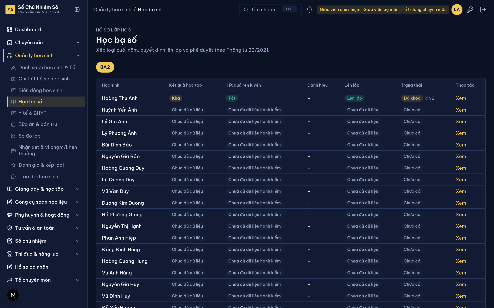

### 2.17 Biến động, bữa ăn & y tế

- **Biến động học sinh** (`/movements` - module `bien_dong_hs`): ghi nhận **chuyển đến**, **chuyển đi**, **bảo lưu**, **nhập học lại** - mỗi biến động lưu loại, ngày, lý do, trường đến/đi. HS chuyển đi/bảo lưu tự loại khỏi sĩ số điểm danh.
- **Bữa ăn & bán trú** (`/meals` - module `bua_an`): đăng ký suất ăn/bán trú của HS lớp mình theo tuần, xem thực đơn, đối chiếu số suất phục vụ bếp.
- **Y tế & BHYT** (`/school/health` - module `y_te_bhyt`): GVCN xem dữ liệu sức khỏe/BHYT của HS lớp mình (phạm vi chỉ đọc theo lớp - nhân viên y tế nhập, mục 7).

### 2.18 Thi/bài tập trực tuyến end-to-end (LMS-lite)

Chuỗi đầy đủ: **tạo đề → tổ chức thi → HS làm → hệ thống chấm theo tham số đề**.

**Bước 1 - Tạo đề** (GV, `anhptl@nd.scn` hoặc `minhtv@nd.scn`):

- Ngân hàng câu hỏi `/studio/questions`: soạn tay, import, hoặc **AI sinh câu hỏi** theo chủ đề/độ khó; các dạng trắc nghiệm 1 đáp án, nhiều đáp án, đúng/sai 4 ý, tự luận ngắn.
- Tổ hợp đề tại `/academics/exams` "Quản lý kỳ thi" hoặc từ ma trận DC-02 trong Studio - mỗi câu mang sẵn **điểm số + đáp án đúng** (đây chính là "tham số" chấm).

**Bước 2 - Tổ chức thi** (GV): menu **Bài tập trực tuyến** (`/lms`) → tạo phiên:

1. Chọn bộ đề + lớp nhận bài + thời gian mở/đóng + thời lượng (phút).
2. Hệ thống **snapshot toàn bộ đáp án + điểm** vào phiên - đề đã giao không thể sửa, đảm bảo công bằng và audit.

**Bước 3 - HS làm bài** (`baong@nd.scn`):

- Portal HS hiện bài trong khung giờ → làm trực tiếp trong trình duyệt → **Nộp bài**. Ngoài khung giờ không vào được (chặn server).

**Bước 4 - Chấm & theo dõi** (GV, tại `/lms/sessions/[id]`):

- Nộp xong server **chấm tự động** theo đáp án snapshot: trắc nghiệm và đúng/sai chấm ngay; câu tự luận gắn cờ `essay_pending` chờ GV chấm tay.
- Bảng theo dõi: ai nộp/chưa nộp, điểm từng em, câu sai nhiều nhất → phân tích tại `/school/exam-analytics`.
- HS xem lại điểm + câu sai ngay trên portal.

---

## 3. Giáo viên bộ môn (GVBM)

**Đăng nhập: `minhtv@nd.scn` / `demo1234`** - GV Vật lý, đơn vai trò.

- **Lịch cá nhân**: vào Thời khóa biểu mặc định hiện toàn bộ tiết mình dạy (xem mục 2.6).
- **Sổ điểm**: nhập điểm các lớp mình dạy - thao tác như mục 2.5.
- **Sổ đầu bài**: ghi tiết mình dạy - thao tác như mục 2.7.
- **Giáo án** (`/academics/lesson-plans`): soạn → nộp tổ trưởng; nếu bị trả về thì sửa theo nhận xét rồi nộp lại.
- **Trao đổi với GVCN** (`/academics/teacher-chat`): chat gắn học sinh cụ thể.
- **Lịch thi** (`/academics/exams`): xem lịch coi thi/thi của lớp mình dạy.
- **Bài tập trực tuyến** (`/lms`): giao bài + chấm như mục 2.18.
- **Studio**: soạn học liệu, ngân hàng câu hỏi - xem mục 12.
- **Năng lực giáo viên**: tự đánh giá + minh chứng - xem mục 2.13.

---

## 4. Tổ trưởng chuyên môn

**Đăng nhập: `hanhlth@nd.scn` / `demo1234`** - Tổ trưởng Tổ Toán-Tự nhiên. Tiểu học: `lienttb@cva.scn`.

- **Trang chủ tổ** (`/team/home`): tổng quan giáo án chờ duyệt, GV trong tổ, sinh hoạt sắp tới.
- **Duyệt giáo án** (`/team/lesson-plans`): danh sách giáo án GV trong tổ nộp → xem nội dung → **AI gợi ý nhận xét** → Duyệt hoặc Trả về kèm nhận xét.
- **Duyệt đánh giá năng lực** (`/team/review`): xét đánh giá tự chấm + minh chứng của GV trong tổ (GV tự chấm tại `/competency/self-assessment`, mục 2.13).
- **Sinh hoạt chuyên môn** (`/team/meetings`): tạo buổi sinh hoạt (chủ đề, ngày, ghi chú) → **AI soạn biên bản** từ ghi chú nhanh.
- **Danh sách giáo viên** (`/team/teachers`): xem GV trong tổ, môn dạy.
- Tổ trưởng vẫn là GVBM - có đủ chức năng mục 3 (TKB, sổ đầu bài, điểm, lịch thi, LMS, Studio).

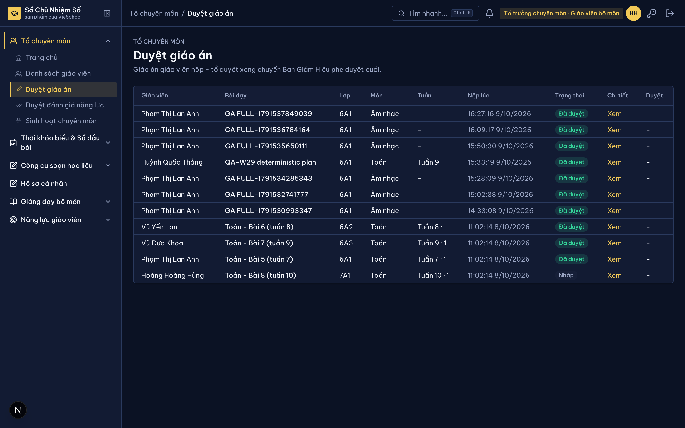
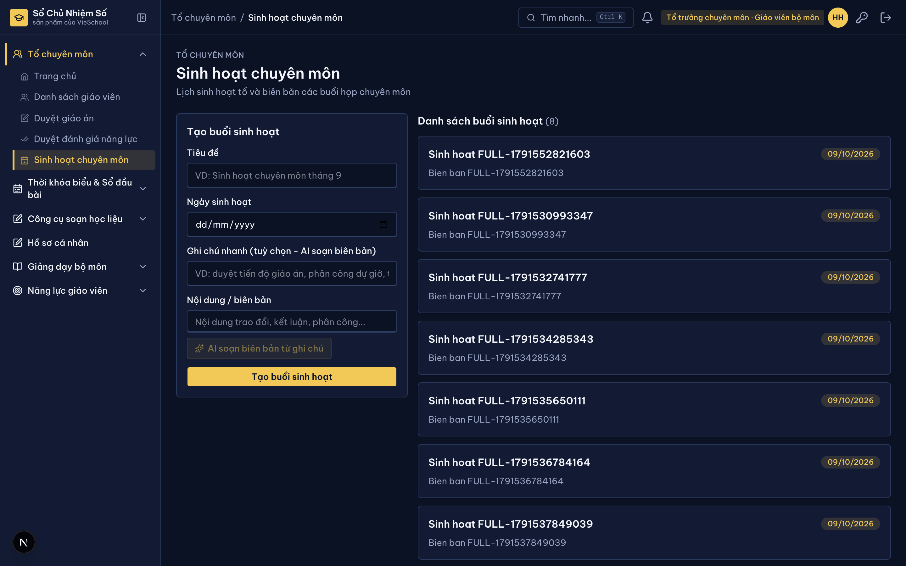

---

## 5. Ban Giám Hiệu (BGH) / Phó Hiệu trưởng (PHT)

**Đăng nhập: `hainv@nd.scn` (BGH) hoặc `duclm@nd.scn` (PHT cơ sở 2) / `demo1234`**. Tiểu học: `phuongttm@cva.scn`, `longhd@kd.scn`.

PHT điều hành vận hành trường (dashboard, radar, sự cố, TKB, CSVC, nhân sự) nhưng **không** ký duyệt sổ chủ nhiệm, không phân công năm học, không quản trị tài khoản - 3 quyền đó chỉ thuộc BGH.

### 5.1 Điều hành

- **Dashboard cấp trường** (`/school/dashboard`): chuyên cần, điểm, sự cố, cảnh báo toàn trường.
- **Trung tâm phê duyệt** (`/school/approvals`): duyệt kế hoạch hoạt động giáo dục (GVCN gửi từ `/activities/plan`, mục 2.11) và các đơn chờ.
- **Báo cáo ngày các lớp** (`/school/daily-reports` - module `chuyen_can`): xem báo cáo GVCN đã gửi (mục 2.3).
- **Điều động dạy thay** (`/school/substitutes` - module `van_hanh_nang_cao`): khi GV vắng, chọn tiết trên TKB → gán GV dạy thay → GV được phân công thấy tiết overlay trên lịch cá nhân; điểm danh tiết tự đồng bộ sổ đầu bài.
- **Radar cảnh báo sớm** (`/school/radar` - module `van_hanh_nang_cao`): danh sách cảnh báo theo mức → **AI đề xuất** can thiệp → Tiếp nhận → Đóng cảnh báo.
- **Trợ lý điều hành (AI)** (`/school/ai-assistant`): chat hỏi đáp trên số liệu thật của trường.
- **Thông báo toàn trường** (`/school/announce`): gửi thông báo cho toàn bộ GV/HS/PH.
- **Sự cố toàn trường** (`/safety/bgh` - module `tu_van_an_toan`): giám sát mọi sự cố, đánh dấu đã báo cáo cấp trên.

### 5.2 Nhân sự & tổ chức

- **Nhân sự trường** (`/school/staff`): danh sách cán bộ, hợp đồng, tổ chuyên môn.
- **Phân công năm học** (`/school/assignments`): chỉ BGH/admin phân công GVCN và lớp + môn dạy của GV.
- **Tài khoản giáo viên** (`/school/users`): tạo/sửa tài khoản cán bộ - họ tên, email, mật khẩu, vai trò chính, **vai trò kiêm nhiệm**, mã nhân viên, loại hợp đồng, cơ sở, tổ chuyên môn; khối "Tổ chuyên môn - môn học" gán môn phụ trách. Chỉ BGH/admin.
- **Định mức biên chế Nghị quyết 37** (`/school/nq37` - module `van_hanh_nang_cao`): đối chiếu biên chế thực tế với định mức.
- **Cơ sở & đánh giá TT15** (`/school/campuses` - module `van_hanh_nang_cao`): khai báo cơ sở chính/phân hiệu - quyết định phạm vi của PHT; tự đánh giá trường theo TT15.
- **Thiết bị & cơ sở vật chất** (`/school/equipment` - module `van_hanh_nang_cao`): sổ tài sản/thiết bị, lịch bảo trì.
- **Kênh liên hệ phụ huynh** (`/school/channels`): cấu hình kênh liên lạc chính thức (email + in-app).
- **Dữ liệu cá nhân** (`/school/privacy` - core, chỉ bgh/admin): 2 sổ theo Luật 91/2025 - **Đồng thuận PHHS** (ghi consent theo HS/mục đích/kênh, thu hồi) và **Yêu cầu quyền chủ thể** (truy cập/sửa/xóa/hạn chế/phản đối/khiếu nại, hạn xử lý 30 ngày, quá hạn tô đỏ, bắt buộc ghi kết quả khi đóng).
- **Chiến lược & chỉ tiêu** (`/school/strategy` - module `van_hanh_nang_cao`): mục tiêu năm học của trường, đối chiếu tiến độ.

### 5.3 Học sinh & chất lượng

- **Học sinh toàn trường** (`/school/students`): tra cứu HS mọi lớp.
- **Xếp thời khóa biểu** (`/schedule/manage`): xếp TKB toàn trường; xem mọi lớp + **Tải template / Import Excel** để xếp hàng loạt (định dạng ô `Môn|GV|Phòng`).
- **Thời khóa biểu theo giáo viên** (`/schedule/by-teacher`): ma trận GV × tiết - phát hiện GV trống/xếp chồng.
- **Điều động giáo viên** (`/schedule/mobilization` - module `dieu_dong`): điều động GV giữa các cơ sở/lớp theo đợt.
- **Sổ đầu bài toàn trường** (`/school/journals`): giám sát tiết đã/chưa ghi của mọi lớp.
- **Xét tốt nghiệp** (`/school/graduation` - module `xet_tot_nghiep`): lớp cuối cấp - kiểm tra điều kiện từng HS theo quy chế, phê duyệt danh sách, xuất quyết định công nhận.
- **Tuyển sinh đầu cấp** (`/school/admissions` - module `tuyen_sinh`): quản lý kỳ tuyển (khối 6 xét tuyển, khối 10 thi tuyển), duyệt hồ sơ từ cổng public, công bố kết quả - chi tiết flow tại mục 11.
- **Thư viện** (`/library` - module `thu_vien`): **Danh mục sách**, **Mượn & trả sách** (`/library/loans` - ghi mượn/trả, theo dõi quá hạn), **Sổ đăng ký cá biệt** (`/library/register` - số ĐKCB theo chuẩn Thư viện Quốc gia).
- **Phân tích điểm thi** (`/school/exam-analytics` - module `ky_thi_danh_gia`): phân tích sau thi toàn trường - phân bố điểm, câu sai nhiều.
- **Bữa ăn & bán trú** (`/meals`), **Y tế & BHYT** (`/school/health`), **Văn thư** (`/school/documents` - module `van_thu`: sổ công văn đến/đi, số hiệu chống trùng, phân xử lý, quá hạn tô đỏ), **Tích hợp & kết nối** (`/school/integrations` - module `tich_hop`: khung connector + outbox, cấu hình khi có credential vendor).
- **Học bạ số** (`/records/hoc-ba`) + **Học bạ XML & ký xác thực** (`/records/exports`) + **Biến động học sinh** (`/movements`): xem mục 2.16, 2.17.

### 5.4 Giám sát & phê duyệt

- **Ký duyệt sổ chủ nhiệm** (`/register/signoff`): **Tạo đợt ký** mở kỳ ký cho tất cả lớp → với từng sổ GVCN đã nộp: **Ký duyệt** hoặc **Từ chối** (bắt buộc nhập lý do - GVCN nhận thông báo kèm lý do để sửa và nộp lại). Nhiều sổ chờ: **Ký duyệt tất cả**. Chỉ BGH/admin ký được - GVCN không tự ký sổ của mình.
- **Duyệt & khóa sổ học bạ** (`/register/lock-records`): mục 2.16 bước 3.
- **Xếp hạng & khen thưởng** (`/emulation/ranking`): duyệt kết quả thi đua toàn trường.
- **Báo cáo thu chi** (`/finance/reports` - module `khoan_thu`): xem báo cáo kế toán.
- **Nhật ký & lịch sử** (`/register/audit`): audit toàn bộ sổ.

> Khởi tạo trường mới từ đầu (tài khoản, cơ sở, tổ, lớp, HS, PH, TKB): xem `KHOI-TAO-TRUONG-MOI.md` kèm file Excel `docs/templates/khoi-tao-truong.xlsx`.

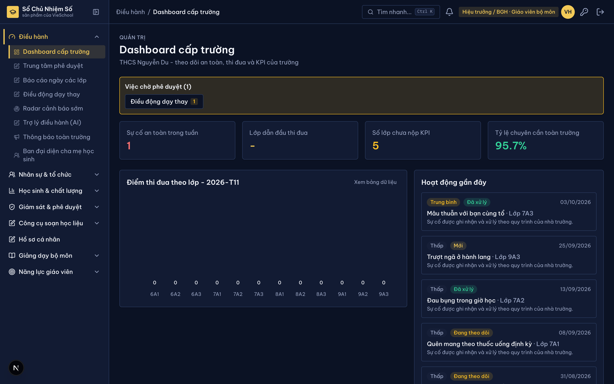
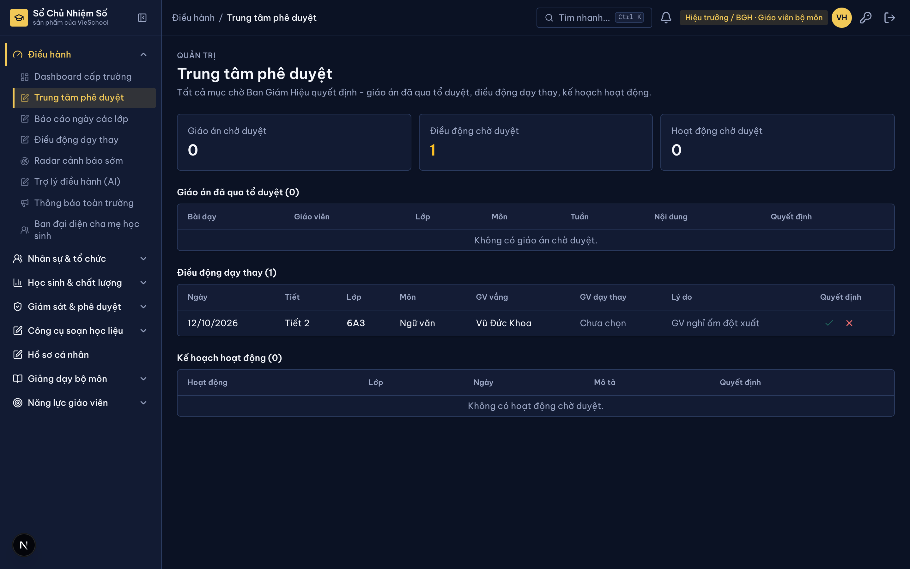
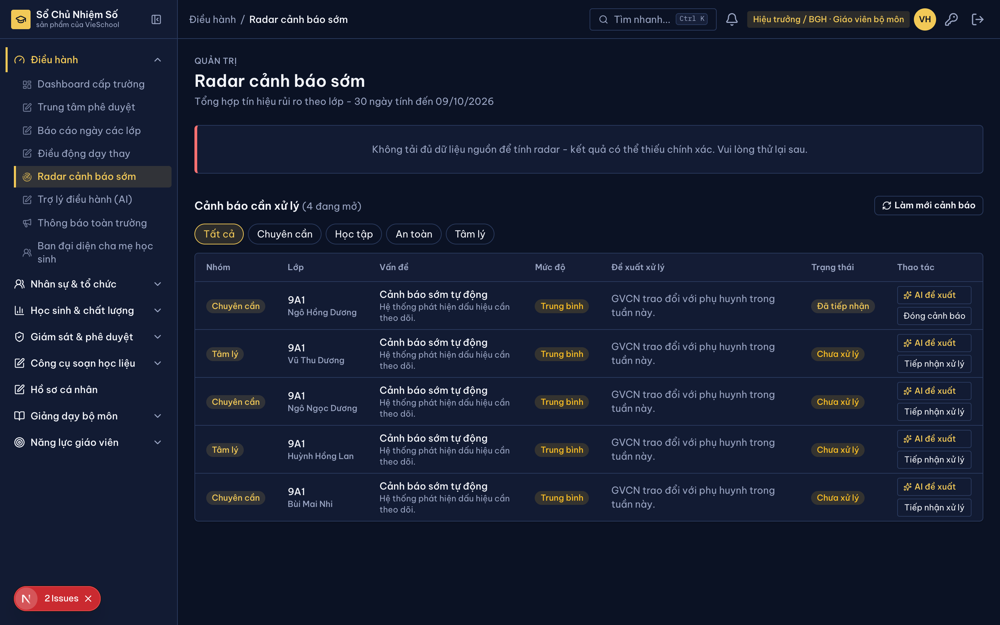
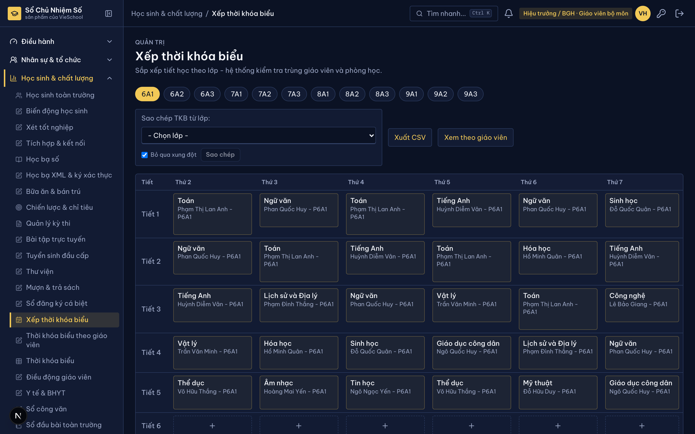
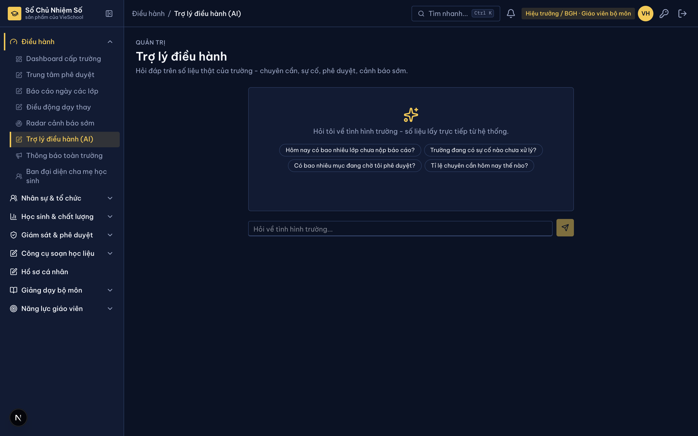

---

## 6. Kế toán trường

**Đăng nhập: `trangpt@nd.scn` / `demo1234`**.

**Khoản thu** (`/finance`) - module `khoan_thu`, quy trình 4 bước:

1. **Danh mục khoản thu** (`/finance/items`): khai báo các loại phí - học phí, tiền ăn, đồng phục, bảo hiểm... mỗi khoản có đơn giá và tính chất (bắt buộc/tự nguyện).
2. **Đợt thu** (`/finance/periods`): mở đợt thu theo tháng/kỳ, gắn khoản thu áp cho từng lớp hoặc cả trường.
3. **Hóa đơn & thu tiền** (`/finance/invoices`): hệ thống sinh hóa đơn theo đợt cho từng HS; ghi nhận thanh toán từng biên lai, xem còn nợ. PH nhận thông báo số tiền phải đóng.
4. **Báo cáo thu chi** (`/finance/reports`): tổng hợp theo đợt/lớp/khoản thu - đã thu, còn nợ, tỷ lệ thu.

**Tích hợp thanh toán** (`/finance/integrations`): cấu hình cổng thanh toán/đối soát khi trường kết nối vendor (QR banking, ví điện tử) - khung sẵn, kích hoạt khi có credential.

**Hành chính khác**: Nhân sự trường, Cơ sở vật chất, Thiết bị (sổ tài sản, bảo trì), Báo cáo NQ37 (định mức biên chế), Bữa ăn & bán trú (`/meals`).

---

## 7. Nhân viên y tế trường

**Đăng nhập: dùng tài khoản BGH/admin (`hainv@nd.scn`) hoặc tài khoản cán bộ được gán vai trò y tế** - demo chưa tách tài khoản riêng; trên trường thật BGH tạo tài khoản y tế tại `/school/users`.

Màn hình **Y tế & BHYT** (`/school/health` - module `y_te_bhyt`) - dữ liệu **nhạy cảm**, RLS scope theo cơ sở:

1. **Sổ khám sức khỏe định kỳ**: tạo đợt khám theo lớp/cơ sở → nhập chiều cao, cân nặng, thị lực, tiền sử bệnh từng HS (validate số liệu inline - chiều cao/cân nặng theo dải hợp lý).
2. **Thẻ BHYT**: khai báo số thẻ, nơi ĐK KCB, hạn thẻ từng HS → cảnh báo thẻ sắp hết hạn.
3. **Phân quyền**: BGH/admin toàn trường; PHT chỉ cơ sở mình phụ trách; GVCN chỉ HS lớp mình; GVBM không thấy.
4. **Pháp lý**: dữ liệu sức khỏe thuộc DLCN nhạy cảm - đồng thuận PHHS ghi tại `/school/privacy` (mục 5.2), DPIA đã kê khai riêng.

---

## 8. Sở GD&ĐT / UBND cấp xã / Quản trị hệ thống

**Đăng nhập: `sovqt@demo.scn` (Sở) hoặc `daonvl@demo.scn` (UBND, chỉ đọc) / `demo1234`**. Quản trị hệ thống: `admin@demo.scn`.

- **Dashboard cấp Sở/địa bàn UBND xã** (`/dept/dashboard`): tổng hợp các trường - quy mô, tỷ lệ chuyên cần, sự cố, cảnh báo; nút **AI bản tin** tổng hợp. (Theo chính quyền địa phương 2 cấp - Phòng GD&ĐT cấp huyện đã bãi bỏ từ 1/7/2025.)
- **Quản lý trường** (`/dept/schools`): tạo trường mới - hệ thống tự tạo năm học hiện tại, tổ chuyên môn mặc định, bộ môn theo cấp học và tài khoản BGH đầu tiên.
- **Quản trị người dùng** (`/dept/users` - Sở): tài khoản các trường.
- **Quản trị dữ liệu** (`/dept/data` - Sở): kiểm tra toàn vẹn - lớp thiếu GVCN, HS chưa có tổ/phụ huynh, liên kết mồ côi.
- **Đơn vị hành chính** (`/dept/wards`): khai báo phường/xã thuộc địa bàn quản lý.
- **Báo cáo tổng hợp** (`/dept/reports`): báo cáo định kỳ các trường - chuyên cần, chất lượng, nhân sự.
- **Hoạt động sử dụng** (`/dept/usage`): mức độ sử dụng hệ thống theo trường - trường nào đăng nhập/nhập liệu ít cần nhắc.
- **Cơ sở vật chất** (`/dept/facilities`): tổng hợp CSVC các trường trong địa bàn.
- **Module theo trường** (`/dept/modules` - Sở/admin): bật/tắt module bán lẻ từng trường - trường mua gói nào mở gói đó (xem bảng module, mục 13).
- **Học bạ số** (`/records/hoc-ba`): xem chỉ đọc học bạ các trường thuộc phạm vi (mục 2.16).

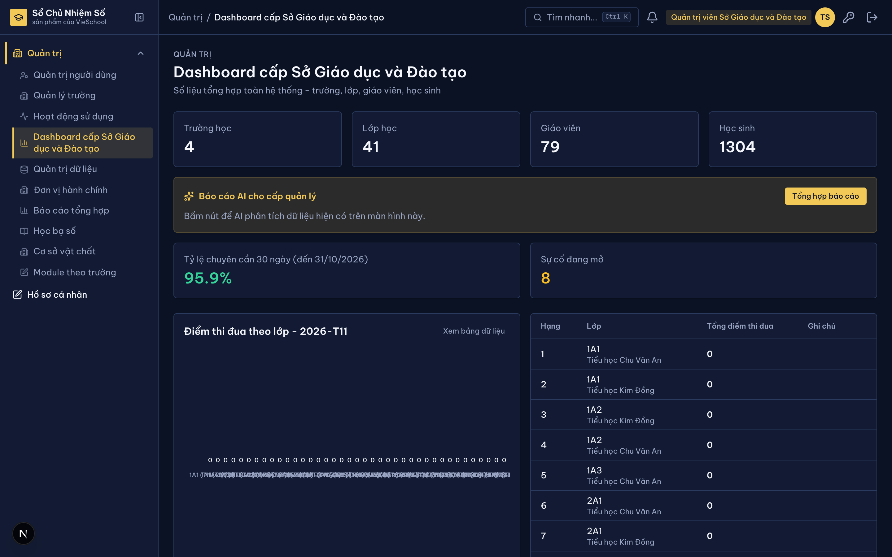
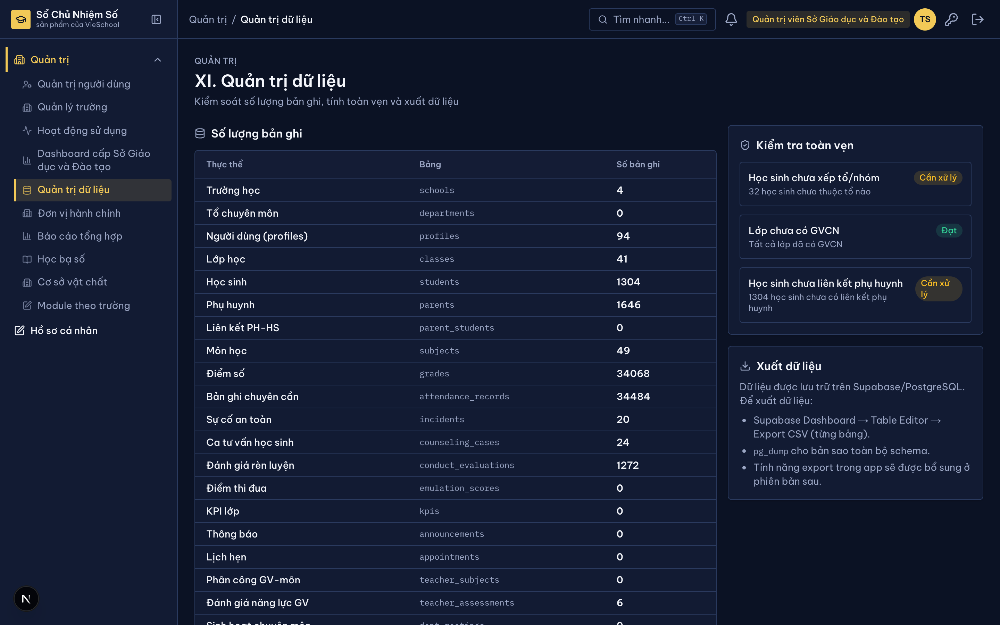

---

## 9. Phụ huynh

**Đăng nhập: `annv@nd.scn` / `demo1234`** - bố em Nguyễn Gia Bảo lớp 8A2.

Portal phụ huynh (`/portal/parent`) hiển thị thông tin con mình (hai PH cùng con thấy chung dữ liệu):

- **Nhiều con**: nếu có từ 2 con trở lên học tại trường, đầu trang có **bộ chọn con** - đổi con để xem đúng dữ liệu từng em (điểm, chuyên cần, thông báo lớp của em đó).
- **Thông báo lớp**: đọc thông báo GVCN gửi; thông báo khoản thu/hóa đơn từ kế toán.
- **Tin nhắn**: **Soạn tin nhắn** gửi thẳng GVCN hoặc **Trả lời** từng tin - cả tin đã gửi và đã nhận đều hiển thị trong cùng một hội thoại.
- **Đặt lịch hẹn**: chọn ngày giờ + mục đích → chờ GVCN xác nhận → trạng thái chuyển "Đã xác nhận".
- **Đăng ký hoạt động**: các hoạt động giáo dục đã công bố (mục 2.11 bước 2) → bấm **Đăng ký** cho con; đổi ý thì **Báo vắng**.
- **Báo nghỉ**: khai báo con nghỉ học kèm lý do → hiển thị ở sổ vắng/muộn của GVCN với nguồn "Phụ huynh báo".
- **Thông tin con**: điểm số theo HK1/HK2/cả năm (TT22), chuyên cần, hạnh kiểm.

Mọi thao tác (đặt hẹn, nhắn tin, đăng ký) chỉ áp dụng cho con đã liên kết với tài khoản - hệ thống kiểm tra quyền sở hữu ở server trước khi ghi.

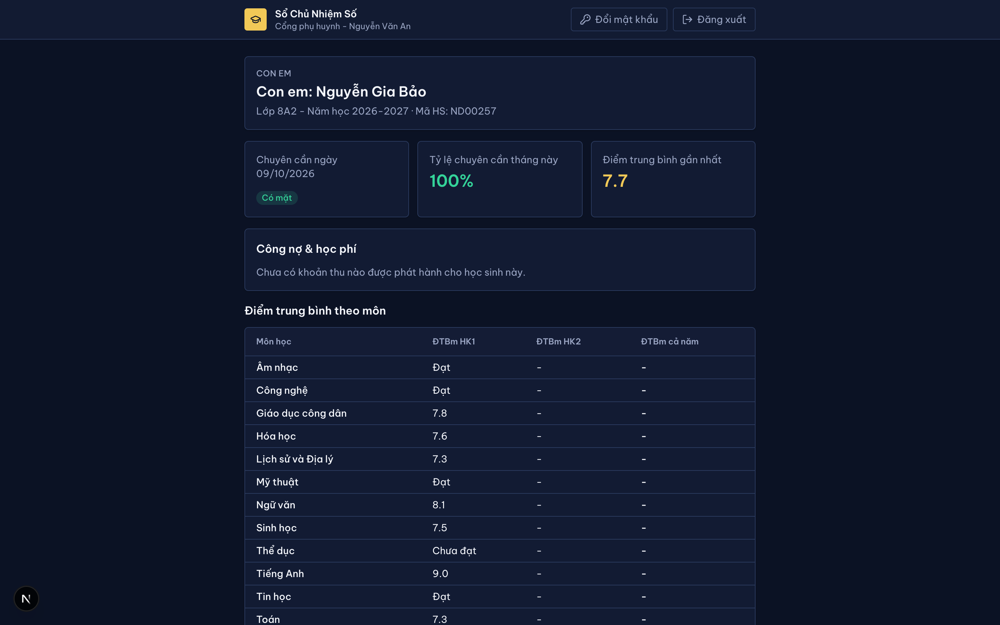

---

## 10. Học sinh

**Đăng nhập: `baong@nd.scn` / `demo1234`** - em Nguyễn Gia Bảo, lớp 8A2.

Portal học sinh (`/portal/student`) xem dữ liệu bản thân: thời khóa biểu, điểm các môn, hạnh kiểm, thông báo lớp, lịch thi.

- **Học bạ** (`/portal/student/hoc-ba`): học bạ cá nhân - điểm HK1/HK2/cả năm từng môn, hạnh kiểm, chuyên cần - cùng dữ liệu GVCN/BGH dùng để ra quyết định cuối năm.
- **Bài tập trực tuyến** (`/portal/student/bai-thi/[sessionId]`): khi GV giao bài (mục 2.18), portal HS hiện bài cần làm → làm trắc nghiệm ngay trong trình duyệt → hệ thống chấm tự động, em xem điểm và đáp án sai.
- **Trao đổi với GVCN**: trả lời tin nhắn GVCN gửi (mục 2.9).

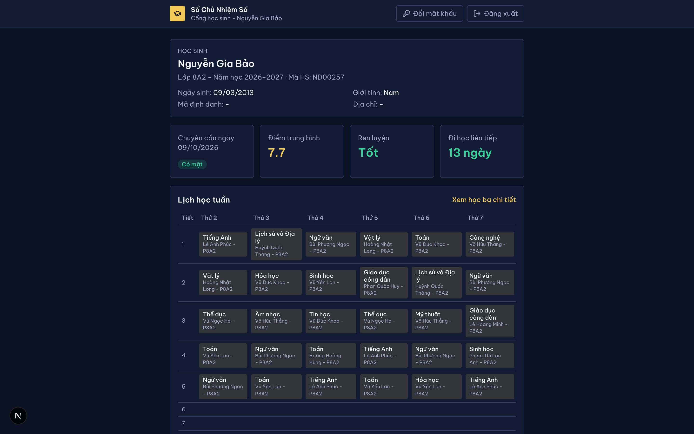

---

## 11. Cổng công khai không cần đăng nhập

Các trang mở cho người ngoài hệ thống - không yêu cầu tài khoản:

- **Nộp hồ sơ tuyển sinh** (`/apply/[id]`): PH truy cập link kỳ tuyển trường công bố → điền form hồ sơ (thông tin HS, PH, nguyện vọng, giấy tờ) → nhận mã hồ sơ.
- **Tra cứu hồ sơ** (`/apply/tra-cuu`): nhập mã hồ sơ → xem trạng thái (chờ duyệt / trúng tuyển / không đạt) và thông báo của trường.
- **Phía trường** (BGH `hainv@nd.scn`): `/school/admissions` duyệt từng hồ sơ → công bố kết quả → HS trúng tuyển chuyển sang danh sách tiếp nhận lớp (mục 2.15).
- **Trang pháp lý** (`/legal/privacy`, `/legal/terms`): chính sách bảo mật + điều khoản sử dụng theo Luật 91/2025 - link từ trang đăng nhập.
- **In học liệu** (`/studio-print/[id]`): trang in/xem học liệu Studio chia sẻ công khai bằng link.

---

## 12. Studio - công cụ soạn học liệu

Dành cho mọi giáo viên (đăng nhập bằng tài khoản GV bất kỳ, vd `minhtv@nd.scn`):

- **Tất cả công cụ** (`/studio`): danh mục công cụ soạn - KHBD, đề thi, bài đọc, bảng ma trận...
- **Ngân hàng câu hỏi** (`/studio/questions`): soạn tay / import / **AI sinh** theo môn + khối + chủ đề + độ khó; các dạng trắc nghiệm, nhiều đáp án, đúng/sai 4 ý, tự luận - duyệt rồi rút vào đề thi và bài LMS.
- **Thư viện của tôi** (`/studio/library`, chi tiết `/studio/library/[id]`): học liệu cá nhân đã soạn - chỉnh sửa, xuất, chia sẻ link in (`/studio-print`).
- **Văn học** (`/studio/literature`, chi tiết `/studio/literature/[id]`): ngân hàng tác phẩm văn học kèm phân tích/hệ thống câu hỏi.
- **Yêu cầu cần đạt của trường** (`/studio/yccd`): khung YCCĐ theo môn/khối trường ban hành - AI sinh câu hỏi bám theo.
- **Biểu mẫu kế hoạch bài dạy** (`/studio/mau-khbd`): mẫu KHBD chuẩn của trường để GV soạn giáo án thống nhất.

---

## 13. Mẹo sử dụng & bảng module

### Mẹo

- **Tìm nhanh**: Ctrl+K mở command palette - gõ tên chức năng/học sinh để nhảy thẳng tới.
- **Ngày/khoảng ngày**: các màn hình chuyên cần đều có chọn ngày hoặc khoảng ngày; đổi giá trị rồi dữ liệu tự cập nhật theo URL (có thể lưu bookmark link kèm ngày).
- **Import Excel**: mọi màn hình có Import đều có nút **Tải template** - luôn tải template mới nhất trước khi import.
- **AI**: các nút AI (tóm tắt, gợi ý, viết lại, sinh câu hỏi) chạy trên dữ liệu thật đang hiển thị; nếu AI bận, hệ thống tự dùng phương án dự phòng - chức năng không đứt.
- **Điện thoại**: giao diện responsive - menu thu vào biểu tượng ☰, bảng cuộn ngang, tên học sinh vẫn hiển thị đầy đủ.
- **Truy cập sai quyền**: vào link của vai trò khác sẽ bị đẩy về trang chủ của mình - không lộ dữ liệu.

### Bảng module bán lẻ (gán theo trường tại `/dept/modules`)

Module là cờ bật/tắt theo trường - trường mua gói nào menu hiện gói đó, trường không mua thì menu ẩn và route từ chối:

| Mã module | Chức năng bật khi mua |
|---|---|
| `chuyen_can` | Báo cáo ngày các lớp (BGH) |
| `ky_thi_danh_gia` | Quản lý kỳ thi, phân tích kết quả, HS cần hỗ trợ, phân tích điểm thi |
| `lms_lite` | Bài tập trực tuyến - giao, làm, chấm tự động |
| `hoc_ba` | Học bạ số, nộp/khóa sổ học bạ |
| `hoc_ba_xml` | Xuất học bạ XML QĐ 3016 + ký xác thực |
| `bien_dong_hs` | Biến động học sinh |
| `y_te_bhyt` | Sổ sức khỏe + thẻ BHYT |
| `bua_an` | Bữa ăn & bán trú |
| `khoan_thu` | Danh mục phí, đợt thu, hóa đơn, báo cáo thu chi |
| `thu_vien` | Thư viện, mượn/trả, sổ ĐKCB |
| `tuyen_sinh` | Tuyển sinh đầu cấp + cổng `/apply` |
| `xet_tot_nghiep` | Xét tốt nghiệp cuối cấp |
| `thi_dua` | Thi đua - chấm điểm, xếp hạng, khen thưởng |
| `tu_van_an_toan` | Sự cố toàn trường (BGH) |
| `phu_huynh_hoat_dong` | Cổng thông tin PH, ban CMHS |
| `van_thu` | Sổ công văn đến/đi |
| `dieu_dong` | Điều động giáo viên |
| `van_hanh_nang_cao` | Dạy thay, radar, trợ lý AI, NQ37, cơ sở TT15, thiết bị, chiến lược |
| `tich_hop` | Tích hợp & kết nối vendor |
